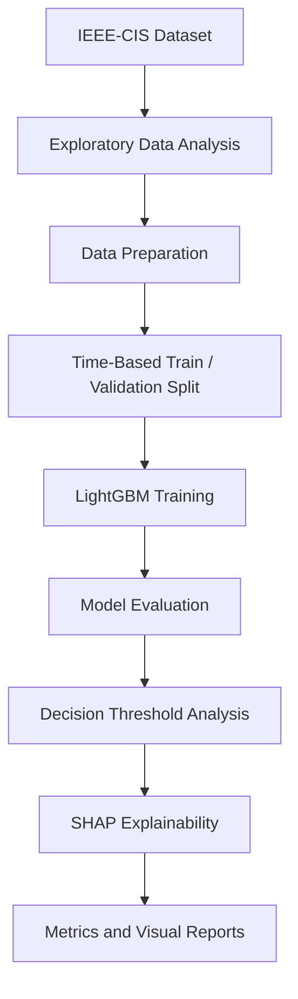
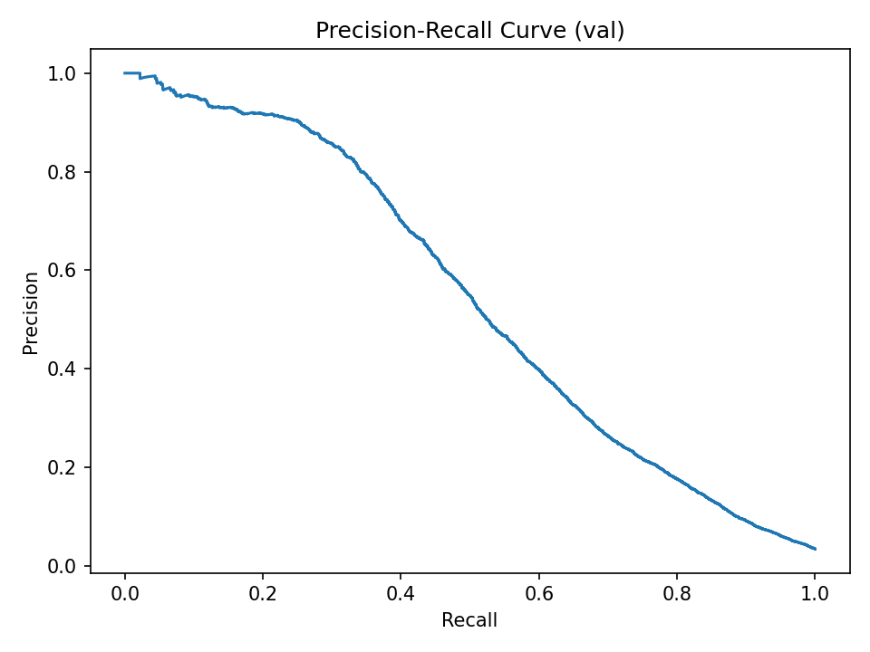
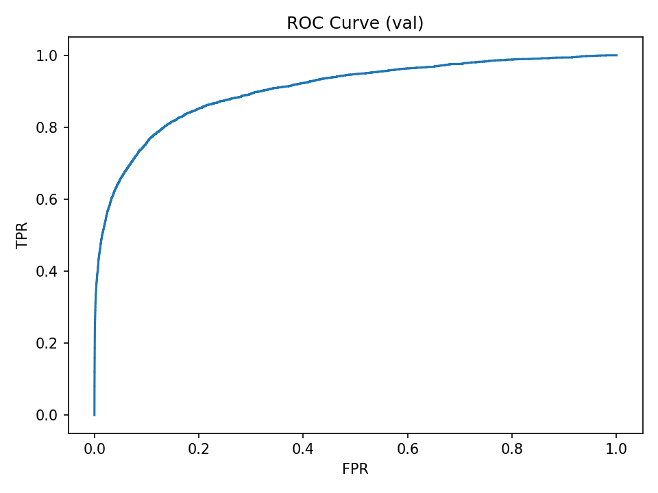
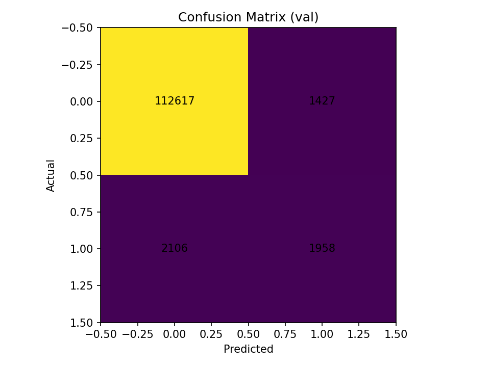
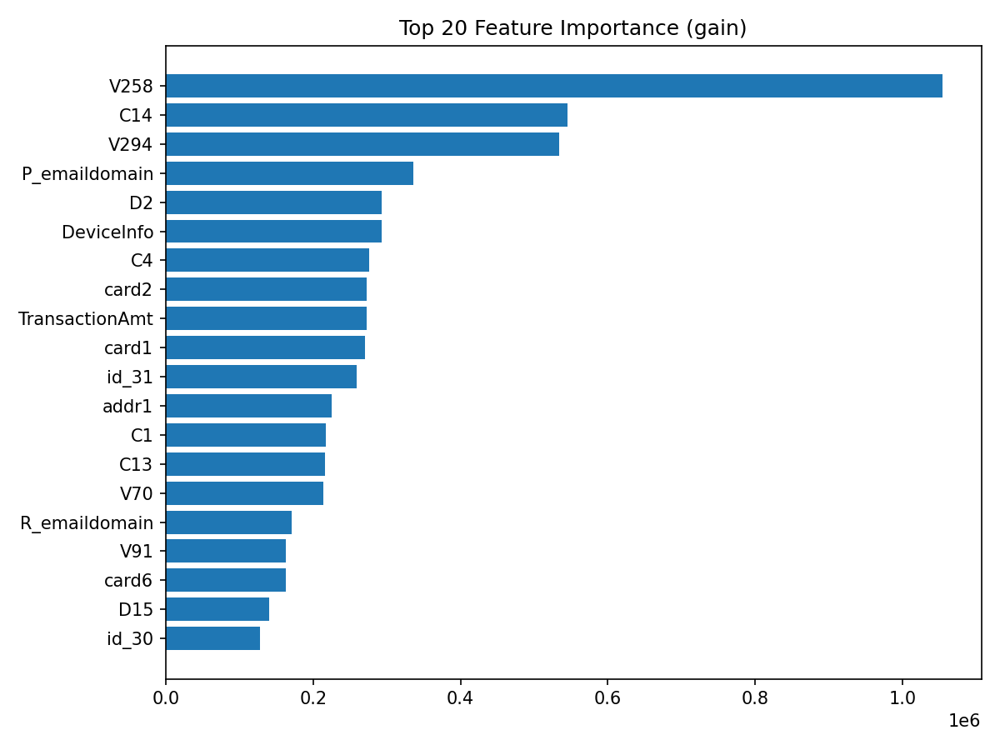
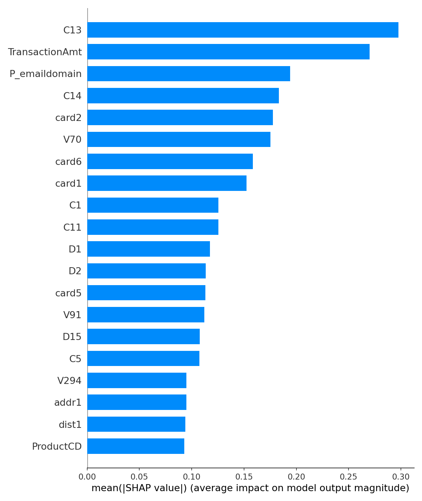

# IEEE-CIS Fraud Detection

### Machine Learning, Time-Based Validation & Explainable AI


IEEE-CIS Fraud Detection is a reproducible machine learning project focused on identifying potentially fraudulent online transactions using the IEEE-CIS dataset.

The project implements an end-to-end workflow covering exploratory data analysis, LightGBM model training, time-based validation, performance evaluation, and SHAP-based model explainability.

It was developed to explore practical challenges in fraud classification, including class imbalance, evaluation strategy, decision thresholds, and model interpretation.

> **Project Focus:** Machine Learning · Fraud Classification · Model Evaluation · Explainable AI

---

## Overview

Fraud detection is a binary classification problem where a model attempts to distinguish fraudulent transactions from legitimate transactions.

A major challenge is that fraudulent transactions are typically much less common than legitimate ones.

This makes model evaluation especially important.

The project focuses on:

- Reproducible model training
- Time-ordered validation
- LightGBM classification
- Precision-recall analysis
- ROC-AUC evaluation
- Decision threshold analysis
- Feature importance
- SHAP explainability

The workflow separates training, evaluation, and explanation into independent scripts.

---

## Machine Learning Pipeline



The pipeline is configured through:

```text
configs/baseline.yaml
```

This helps keep model execution and experimental parameters reproducible.

---

## Dataset

The project uses the IEEE-CIS Fraud Detection dataset from Kaggle.

**Source:** [IEEE-CIS Fraud Detection — Kaggle](https://www.kaggle.com/competitions/ieee-fraud-detection/data)

The dataset contains transaction information and a binary fraud target named:

```text
isFraud
```

The official dataset includes transaction and identity files linked through `TransactionID`.

The project's exact feature selection and data-loading behaviour are determined by its training configuration and implementation.

### Data Access

Download the dataset from Kaggle after accepting the applicable competition rules.

Place the required files in the locations specified by:

```text
configs/baseline.yaml
```

Raw competition data should be obtained from the official source rather than redistributed without permission.

---

## Model Development

### LightGBM Baseline

The project uses LightGBM as its baseline fraud classification model.

LightGBM is suitable for experimenting with structured tabular features and provides feature importance outputs for interpretation.

The project separates:

- Model training
- Performance evaluation
- Model explanation

This structure supports repeatable experiments and comparison of analytical outputs.

---

## Validation Strategy

### Time-Based Split

The documented experiment uses an 80/20 split ordered by:

```text
TransactionDT
```

| Partition | Percentage |
| :--- | ---: |
| Training | 80% |
| Validation | 20% |

Unlike a purely random split, this approach evaluates the model on later observations relative to the training portion.

`TransactionDT` represents elapsed time from an unspecified reference point, not a calendar date.

Time-ordered validation is useful for studying temporal generalisation, although it does not eliminate every possible source of data leakage or guarantee future production performance.

---

## Model Performance

### Reported Validation Results

| Metric | Result |
| :--- | ---: |
| **PR-AUC** | **0.5427** |
| **ROC-AUC** | **0.9052** |
| **Best-F1 Threshold** | **0.7293** |

These are the results documented for the project's time-based validation experiment.

They are not independent production benchmarks.

### Understanding the Metrics

**PR-AUC**

Summarises the relationship between precision and recall.

It is particularly useful when evaluating models on datasets with relatively few positive examples.

**ROC-AUC**

Measures how well the model ranks positive examples above negative examples across different decision thresholds.

**Best-F1 Threshold**

Represents the documented classification threshold associated with the best F1 result in the evaluation workflow.

Threshold selection matters because different thresholds produce different tradeoffs between false positives and missed fraud cases.

A threshold chosen using validation data should be checked on independent data before production use.

---

## Evaluation Visualisations

### Precision–Recall Curve



The precision-recall curve helps assess the model's ability to identify fraudulent transactions while controlling false positives.

<details>
<summary><b>View Additional Evaluation Figures</b></summary>

### ROC Curve



### Confusion Matrix



### Top 20 Feature Importances



### SHAP Summary



</details>

---

## Explainable AI

### SHAP Analysis

The project uses SHAP to examine feature contributions to model predictions.

SHAP helps explain how individual features influence the model's output relative to its reference prediction.

The analysis provides an additional perspective beyond aggregate evaluation metrics.

### Feature Importance

The project also generates LightGBM feature importance results.

Together, these techniques support:

- Identification of influential features
- Model behaviour inspection
- Comparison of feature contributions
- Investigation of potentially unexpected model behaviour

**Important:** Feature importance and SHAP values describe model behaviour. They do not establish causal relationships.

---

## Technology Stack

| Technology | Purpose |
| :--- | :--- |
| Python | Machine learning development |
| LightGBM | Gradient-boosted classification |
| SHAP | Model explainability |
| Scikit-learn | Evaluation and ML utilities |
| Pandas | Data manipulation |
| NumPy | Numerical operations |
| Matplotlib | Evaluation visualisations |
| Jupyter Notebook | Exploratory data analysis |
| YAML | Experiment configuration |
| GitHub Actions | CI workflow |

The specific installed dependencies and versions are defined in:

```text
requirements.txt
```

---

## Getting Started

### Prerequisites

- Python
- pip
- Access to the IEEE-CIS dataset
- Required dataset files at the configured paths

### 1. Clone the Repository

```bash
git clone https://github.com/GaneshPokharel-tech/ieee-cis-fraud-detection.git
cd ieee-cis-fraud-detection
```

### 2. Create a Virtual Environment

```bash
python3 -m venv .venv
```

Activate the environment:

```bash
source .venv/bin/activate
```

### 3. Install Dependencies

```bash
pip install -r requirements.txt
```

### 4. Prepare the Dataset

Download the required IEEE-CIS files from Kaggle.

Check and update the configured data paths in:

```text
configs/baseline.yaml
```

### 5. Train the Model

```bash
python -m src.train_lgbm --config configs/baseline.yaml
```

### 6. Evaluate the Model

```bash
python -m src.evaluate --config configs/baseline.yaml
```

This stage produces evaluation outputs such as:

- Precision-recall curve
- ROC curve
- Confusion matrix
- Feature importance

### 7. Generate SHAP Explanations

```bash
python -m src.explain --config configs/baseline.yaml
```

The explanation stage generates SHAP-based model interpretation artifacts.

---

## Project Structure

```text
ieee-cis-fraud-detection/
│
├── notebooks/
│   └── Exploratory analysis
│
├── src/
│   ├── Training scripts
│   ├── Evaluation scripts
│   └── Explainability scripts
│
├── configs/
│   └── baseline.yaml
│
├── reports/
│   ├── Metrics
│   └── figures/
│       ├── pr_curve_lgbm.png
│       ├── roc_curve_lgbm.png
│       ├── confusion_matrix_lgbm.png
│       ├── feature_importance_top20.png
│       └── shap_summary_bar.png
│
├── requirements.txt
└── README.md
```

### Component Responsibilities

| Directory | Responsibility |
| :--- | :--- |
| `notebooks/` | Exploratory data analysis |
| `src/` | Model training, evaluation, and explanation |
| `configs/` | Experiment parameters and paths |
| `reports/` | Evaluation results and figures |

---

## Reproducibility

The project uses configuration-driven scripts for model training, evaluation, and explanation.

The intended workflow is:

1. Prepare the required dataset.
2. Use the experiment configuration.
3. Train the LightGBM baseline.
4. Evaluate the trained model.
5. Generate explanation artifacts.
6. Compare generated results with the documented experiment.

Results can vary if data preprocessing, library versions, random seeds, or configuration parameters change.

---

## Limitations

- The reported metrics reflect a specific validation experiment.
- Performance on new or future transaction data has not been established.
- Fraud classification involves tradeoffs between false positives and missed fraudulent activity.
- A validation-selected threshold may not generalise to independent data.
- SHAP values explain model predictions but do not prove causality.
- Dataset access is subject to Kaggle competition rules.
- This repository demonstrates an ML workflow rather than a deployed fraud prevention system.

---

## Future Improvements

Potential areas for further experimentation include:

- Additional model baselines
- Hyperparameter optimisation
- Stronger temporal validation
- Feature engineering experiments
- Class imbalance strategies
- Threshold and cost-sensitive evaluation
- Model calibration
- Data drift analysis
- Independent holdout testing

These are possible improvements, not claims about the current implementation.

---

## Author

**Ganesh Pokharel**

AI Engineer | Python Developer

[GitHub](https://github.com/GaneshPokharel-tech) · [LinkedIn](https://www.linkedin.com/in/ganesh-pokharel-30786b192/)

---

*A reproducible machine learning project exploring transaction fraud classification, time-based validation, and explainable AI.*
